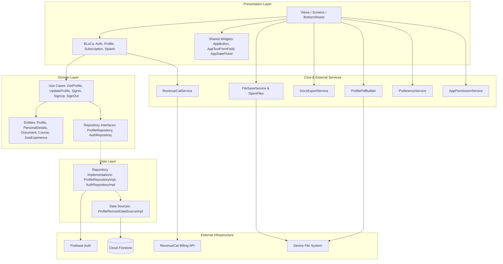

# REDESIGN AUDIT: Seafarer Bio Data Flutter App
**Document Version:** 1.0.0  
**Target Branch for Redesign:** `app-redesign`  
**Base Branch:** `dev`  
**Purpose:** Pre-redesign technical, architectural, and behavioral audit to ensure zero behavioral, state, or test regression during UI overhaul.

---

## 1. TECH STACK

| Category | Technology / Package | Version (from `pubspec.yaml`) | Notes / Constraints |
| :--- | :--- | :--- | :--- |
| **Framework & Engine** | Flutter SDK | `sdk: flutter` (Dart `^3.10.4`) | Material 3 enabled (`useMaterial3: true`). |
| **Language** | Dart | `^3.10.4` | Null-safe Dart codebase. |
| **State Management** | `flutter_bloc` & `equatable` | `flutter_bloc: ^8.1.5`<br>`equatable: ^2.0.5` | BLoC pattern with event-driven state transitions. State equality via Equatable props. |
| **Dependency Injection** | `get_it` | `^9.2.0` | Service locator pattern initialized in `setupLocator()` (`lib/core/di/injection_container.dart`). |
| **Navigation & Routing** | Flutter Navigator 1.0 | Built-in | Centralized route table and route generator in `AppRoutes` (`lib/core/constants/app_routes.dart`). |
| **Backend & Authentication** | Firebase | `firebase_core: ^4.3.0`<br>`firebase_auth: ^6.1.3`<br>`cloud_firestore: ^6.1.1` | Firebase Auth (Email/Password), Cloud Firestore (`profiles/{uid}` document). |
| **Local Storage** | `shared_preferences` | `^2.2.3` | Wrapped by static service `PreferenceService` (`lib/core/utils/shared_preferences.dart`). |
| **Payments & In-App Purchases** | RevenueCat | `purchases_flutter: ^9.13.1`<br>`purchases_ui_flutter: ^9.13.1` | Configured via `RevenueCatService`. Entitlement: `pro`; Offering: `seafarer`. |
| **Document Generation** | PDF & DOCX | `pdf: ^3.11.3`<br>`printing: ^5.12.0`<br>`docs_gee: ^1.2.2` | PDF built via `pdf/widgets.dart`; DOCX built via `docs_gee` (gated by Pro subscription). |
| **Files & Native Integration** | System I/O & Permissions | `path_provider: ^2.1.2`<br>`open_filex: ^4.4.0`<br>`permission_handler: ^11.3.0`<br>`image_picker: ^1.2.1`<br>`url_launcher: ^6.3.2`<br>`dio: ^5.4.0` | Image picking (gallery), document opening via `OpenFilex`, permission requests via `AppPermissionService`. |
| **UI Helpers** | Assets & Steps | `flutter_svg: ^2.2.3`<br>`step_progress: ^2.7.1`<br>`cupertino_icons: ^1.0.8` | Vector icons and multi-step wizard bar. |
| **Environment Configuration** | `flutter_dotenv` | `^6.0.0` | `.env.dev` and `.env.prod` loaded dynamically based on `--dart-define=FLAVOR`. |

---

## 2. ARCHITECTURE & FOLDER STRUCTURE

The project is structured according to Clean Architecture principles with Feature-Driven packaging:

```
lib/
├── core/
│   ├── config/              # Environment configurations (.env loader, flavors)
│   ├── constants/           # Colors, themes, routes, dimensions, payment constants
│   ├── di/                  # Service locator (GetIt setupLocator)
│   ├── pdf/                 # Profile PDF builder document generator
│   ├── services/            # RevenueCat, DOCX export, File save, Permissions, Firebase
│   └── utils/               # AppValidators, SharedPreferences helper, String extensions
├── features/
│   ├── auth/                # Sign In, Sign Up, Sign Out (data, domain, presentation)
│   ├── onboarding/          # Walkthrough pages and content models
│   ├── personal_details/    # Home (view mode), EditDetails (edit mode), ProfileCompletion
│   ├── splash/              # Splash screen and routing decider
│   └── subscription/        # Paywall, subscription packages, purchase & restore bloc
├── widgets/                 # Cross-feature reusable atomic components
├── firebase_options.dart    # Firebase CLI generated config
└── main.dart                # App entrypoint, global MultiBlocProvider, root MaterialApp
```

### Architectural Layers

1. **Presentation Layer (`features/*/presentation/`):**
   - **Views / Pages:** Build UI structure, listen to BLoCs using `BlocListener`, `BlocBuilder`, or `BlocConsumer`.
   - **BLoCs (`*Bloc`):** Receive user interaction events, coordinate with domain use cases, emit immutable states.
2. **Domain Layer (`features/*/domain/`):**
   - **Entities:** Pure Dart models (`Profile`, `PersonalDetails`, `Document`, `Course`, `SeaExperience`).
   - **Use Cases:** Encapsulate business actions (`GetProfileUseCase`, `UpdateProfileUseCase`, `SignInUseCase`, etc.).
   - **Repository Interfaces:** Abstract contracts (`ProfileRepository`, `AuthRepository`).
3. **Data Layer (`features/*/data/`):**
   - **Data Sources:** Direct interactions with Firebase Firestore (`ProfileRemoteDataSourceImpl`).
   - **Repository Implementations:** Coordinate between data sources and map Firestore JSON maps to Domain Entities.
4. **Core Services Layer (`core/services/`):**
   - Independent infrastructure bridges for external systems: `RevenueCatService`, `DocxExportService`, `FileSaveService`, `AppPermissionService`.

### Architecture Dependency Diagram



---

## 3. SCREEN & MODAL INVENTORY

| Screen / Dialog / Sheet | File Path | Widgets / Components Used | State Read | State Written / Events Emitted | Navigation In | Navigation Out |
| :--- | :--- | :--- | :--- | :--- | :--- | :--- |
| **Splash Screen** | `lib/features/splash/splash_screen.dart` | `Image.asset('assets/images/app_logo.png')`, `AppTextView`, `MultiBlocListener` | `SplashState`, `AuthState`, `ProfileState`, `PreferenceService` flags | `LoadSplash`, `LoadProfile` | Cold App Start | `AppRoutes.onboarding`, `AppRoutes.login`, `AppRoutes.profileCompletion`, or `AppRoutes.home` |
| **Onboarding Page** | `lib/features/onboarding/onboarding_page.dart` | `PageView.builder`, `_OnboardingCard`, `_DotsIndicator`, `ElevatedButton`, `TextButton` | Local `_currentIndex` | `PreferenceService.setOnboardingCompleted(true)` | From `SplashScreen` (if first open) | `AppRoutes.login` (via "Skip" or "Get Started") |
| **Login Page** | `lib/features/auth/presentation/pages/login_page.dart` | `Form` (`_formLoginKey`), `AppTextFormField` (email, password), `AppButton` ("Sign In"), `SvgPicture` (eye/eye_off), `TextButton` | `AuthState` (`AuthPasswordObscuredState`, `AuthLoading`), `ProfileState` | `SignInEvent`, `TogglePasswordVisibility`, `LoadProfile` | `AppRoutes.login`, Logout, Splash | `AppRoutes.signup`, `AppRoutes.home` (if profile completed), `AppRoutes.profileCompletion` (if incomplete) |
| **Sign Up Page** | `lib/features/auth/presentation/pages/signup_page.dart` | `Form` (`_signUpFormKey`), `AppTextFormField` (firstname, lastname, email, password, confirmPassword), `AppButton`, `TextButton` | `AuthState` (`AuthPasswordObscuredState`, `AuthLoading`) | `SignUpEvent`, `TogglePasswordVisibility`, `LoadProfile` | `AppRoutes.signup`, Login screen link | `AppRoutes.login`, `AppRoutes.profileCompletion` (on success) |
| **My Bio Data (View Mode)** | `lib/features/personal_details/presentation/view/home_page.dart` | `AppBar` with SVG actions (PDF, DOCX, Pro icon, Edit, Logout), `SingleChildScrollView`, `Table` (3 tables), `AppTextWithLabel`, `ProfileSubscriptionCard` | `ProfileState` (`ProfileLoaded`), `SubscriptionState` (`SubscriptionActive`), `AuthState` | `SignOutEvent`, `LoadProfile`, `FetchPlans`, `CustomerInfoUpdated` | Login, ProfileCompletion, Splash | `AppRoutes.editProfile`, `AppRoutes.subscription`, `AppRoutes.login` (on logout) |
| **My Bio Data (Edit Mode)** | `lib/features/personal_details/presentation/view/edit_details.dart` | `Form` (`_formKey`), `AppTextFormField`, `AppDatePicker`, `DocumentWrapperWidget`, `CourseWrapperWidget`, `SeaExperienceWidget`, `NotFoundWidget`, `AppButton` ("Save Changes") | `ProfileState` (`ProfileLoaded`, `ProfileLoading`) | `UpdateFullProfileEvent` | `HomePage` AppBar edit icon | Pops back to `HomePage` via Back button (Save Changes shows SnackBar) |
| **Profile Completion (Wizard)** | `lib/features/personal_details/presentation/view/profile_completion.dart` | `StepProgressController`, `PageView.builder` (3 pages), 3 `Form`s (`_form1Key`, `_form2Key`, `_form3Key`), `AppTextFormField`, `AppDatePicker`, `DocumentWrapperWidget`, `CourseWrapperWidget`, `AppButton` | `ProfileState` (`ProfileLoaded`, `ProfileLoading`, `PersonalDetailsUpdateSuccess`, etc.) | `UpdatePersonalDetailsEvent`, `UpdateDocumentsEvent`, `UpdateCoursesEvent`, `LoadProfile` | Login/SignUp (if profile incomplete), Splash | `AppRoutes.home` upon step 3 completion |
| **Upgrade to Pro (Paywall)** | `lib/features/subscription/presentation/view/subscription_page.dart` | `AppBar`, `GestureDetector` Plan Cards, Badge tags ("MOST POPULAR", "BEST VALUE"), `TextButton` ("Restore Purchases", "Terms of Use", "Privacy Policy") | `SubscriptionState` (`PlansLoaded`, `SubscriptionLoading`, `SubscriptionActive`, `SubscriptionError`) | `FetchPlans`, `PurchasePlan`, `RestorePurchase` | `HomePage` DOCX upgrade prompt, ProfileSubscriptionCard "Upgrade to Pro" | Pops back (`Navigator.pop`) on success or close |
| **Add Document / Course Sheet** | BottomSheet inside `edit_details.dart:505` & `profile_completion.dart:550` | `showModalBottomSheet`, `AppTextView`, `AppTextFormField` (name), `ElevatedButton` ("Add to List") | Local text controller | Adds `ProfileControllerWrapper` or `ProfileCourseControllerWrapper` to local UI state | Tap `add-icon.svg` on Documents or Courses | `Navigator.pop(context)` |
| **Add / Edit Sea Experience Sheet** | BottomSheet inside `edit_details.dart:548` | `showModalBottomSheet`, `AppTextFormField` (vesselName, company, type, rank, grt, bhp), `AppDatePicker` (from, to), `AppButton` ("Add Experience" / "Edit Sea Experience") | Reads `wrapper` controllers & calculates months | Appends/updates `SeaExperienceControllerWrapper` in local state | Tap `add-icon.svg` on Sea Experience, or tap `edit_note` on item card | `Navigator.pop(context)` |
| **PDF Preview Page** | `lib/features/personal_details/presentation/view/pdf_preview.dart` | `Scaffold`, `AppBar` with download action, `PdfPreview` (printing package) | Takes `Profile` parameter | Calls `ProfilePdfBuilder.generateAndSave` | Not currently wired in `AppRoutes` (used in tests / fallback preview) | `Navigator.pop(context)` |
| **Upload Photo Sheet** | `lib/widgets/bottomsheet/bottom_sheet_upload_image.dart` | `showModalBottomSheet`, `ListTile` ("Take photo from camera", "Choose from gallery") | None | Returns `ImageSource.camera` or `ImageSource.gallery` | Edit details / Profile completion photo tap | `Navigator.pop(context, source)` |
| **Customer Center Sheet** | In RevenueCat SDK | Native RevenueCat UI via `RevenueCatUI.presentCustomerCenter()` | Active RevenueCat subscription | Modifies subscription with Google Play / App Store | `HomePage` AppBar premium icon | Returns to app |

---

## 4. FEATURE INVENTORY & CODE PATHS

### 1. Authentication & Session Persistence
- **Sign In:** `LoginPage` -> `SignInEvent(email, password)` -> `SignInUseCase` -> `AuthRepositoryImpl.signIn()` (`FirebaseAuth.instance.signInWithEmailAndPassword`) -> On success: `PreferenceService.setUserId(user.uid)`, `PreferenceService.setLoggedIn(true)`, `RevenueCatService.logIn(user.uid)` -> Emits `Authenticated(user)`.
- **Sign Up:** `SignUpPage` -> `SignUpEvent(firstname, lastname, email, password)` -> `SignUpUseCase` -> Creates Auth account + initial Firestore profile document (`ProfileRepositoryImpl.saveProfile`) -> Emits `SignUpSuccess(user)` -> Navigates to `ProfileCompletion`.
- **Session Check on Boot:** `SplashScreen` -> `SplashBloc.add(LoadSplash())` -> Reads `PreferenceService.isOnboardingCompleted`, `PreferenceService.isLoggedIn`, `PreferenceService.isProfileCompleted` -> Decides initial route.
- **Session Stream Listener:** `AuthBloc` subscribes to `FirebaseAuth.instance.authStateChanges()` (`lib/features/auth/presentation/bloc/auth_bloc.dart:51`).

### 2. Logout Flow
- **Code Path:** `HomePage` AppBar logout action (`home_page.dart:219`) -> `context.read<AuthBloc>().add(SignOutEvent())`.
- **Execution:** Calls `SignOutUseCase` -> Clears `PreferenceService` (userId, loggedIn, profileCompleted, onboardingCompleted) -> Calls `RevenueCatService.logOut()` -> Emits `ResetSubscriptionState()` on `SubscriptionBloc` -> Emits `Unauthenticated()` -> `BlocConsumer` runs `Navigator.pushNamedAndRemoveUntil(AppRoutes.login, (_) => false)`.

### 3. Profile View & Edit
- **View:** `HomePage` builds UI using `ProfileLoaded` state (`state.profile`). Displays personal details, profile picture (Base64), and 3 formatted scrollable `Table`s for Documents, Courses, and Sea Experiences.
- **Edit:** `EditDetails` receives current state in `initState()`, maps domain entities into editable wrapper objects (`_docWrappers`, `_certificateWrapperList`, `seaExperienceList`), binds text controllers, and upon clicking "Save Changes" emits `UpdateFullProfileEvent` to `ProfileBloc`.
- **Firestore Update:** `ProfileBloc._onUpdateFullProfile` merges changes and writes directly to Cloud Firestore `profiles/{userId}` via `ProfileRepositoryImpl.updateProfile`.

### 4. Photo Upload & Storage
- **Code Path:** `EditDetails:317` -> calls `AppPermissionService.requestPhotosPermission()` -> `ImagePicker.pickImage(source: ImageSource.gallery, maxWidth: 512, maxHeight: 512, imageQuality: 80)` -> Reads raw bytes -> Encodes to Base64 string (`base64Encode(bytes)`) -> Saved directly into `personalDetails.profilePic` string on Firestore (no Cloud Storage bucket dependency).
- **Rendering:** Decoded in `home_page.dart:257` via `base64Decode(profile.personalDetails.profilePic)` and rendered via `Image.memory(decodeImage)`.

### 5. Dynamic Documents, Courses, and Sea Experience
- **Documents / Courses:**
  - Added via bottom sheet `_showAddDocumentSheet` -> Instantiates `ProfileControllerWrapper` / `ProfileCourseControllerWrapper`.
  - Rendered via `DocumentWrapperWidget` and `CourseWrapperWidget`.
  - Deleted via `onDelete` callback which removes the wrapper at index from list and calls `setState()`.
- **Sea Experience:**
  - Added/Edited via `_showAddExperienceSheet` -> Instantiates/mutates `SeaExperienceControllerWrapper`.
  - Rendered via `SeaExperienceWidget` with Edit (`Icons.edit_note`) and Delete (`Icons.delete_outline`) buttons.

### 6. Auto "Period in Months" Calculation
- **Code Path:** `EditDetails._calculatePeriod(SeaExperienceControllerWrapper wrapper)` (`lib/features/personal_details/presentation/view/edit_details.dart:111-141`).
- **Algorithm:** Parses date strings in format `dd.mm.yyyy`. Calculates `months = (to.year - from.year) * 12 + (to.month - from.month)`. If `to.day < from.day`, decrements months by 1. Clamps negative result to `"0"`. Writes directly to `wrapper.periodController.text`.

### 7. Form Validation Rules
- **Centralized Validator:** `AppValidators` (`lib/core/utils/app_validators.dart`):
  - `name`: Not empty, trimmed, minimum 2 characters.
  - `post`: Not empty, trimmed, minimum 2 characters.
  - `email`: Regex `r'^[\w-\.]+@([\w-]+\.)+[\w-]{2,4}$'`.
  - `password`: Not empty, minimum 8 characters.
  - `confirmPassword`: Checks match with original password controller text.
  - `dob` & `nationality`: Non-empty checks.
  - `required`: Field-specific required message.

### 8. Save Changes & SnackBar Feedback
- **In `EditDetails`:** Clicking `AppButton(title: "Save Changes")` validates `_formKey.currentState!.validate()`. If valid, dispatches `UpdateFullProfileEvent`. A `BlocListener` in `EditDetails` listens for `ProfileLoaded` and triggers `ScaffoldMessenger.of(context).showSnackBar` with text `"Profile Updated Successfully"`. Note: It currently stays on `EditDetails` without popping.

### 9. PDF Export
- **Code Path:** `HomePage` AppBar PDF icon (`home_page.dart:43-46`).
- **Builder:** `ProfilePdfBuilder.generateAndSave(profile: state.profile)` (`lib/core/pdf/profile_pdf_builder.dart`).
- **Generation:** Uses `pdf/widgets.dart` generating an A4 multi-page document containing Header, Personal Info, Documents Table, Courses Table, and Sea Experience Table.
- **Viewing/Opening:** Writes to `${dir.path}/seafarer_bio_data_${firstname}.pdf` and calls `OpenFilex.open(file.path)` to hand off to the OS PDF viewer.

### 10. DOCX Export (Pro Gated)
- **Code Path:** `HomePage` AppBar DOC icon (`home_page.dart:83-169`).
- **Gate Enforcement (PAY-SEC-001/002):** Checks `subscriptionState is SubscriptionActive`. If not active, makes direct fallback check via `RevenueCatService.getCustomerInfo()` and `isProSubscriber()`.
- **Subscribed Flow:** Displays SnackBar `"Generating DOCX..."` -> Calls `DocxExportService.generateSeafarerDocx(profile, isSubscribed: true)` -> Uses `docs_gee` package -> Saved via `FileSaveService.saveAndOpen(bytes, fileName)`.
- **Unsubscribed Flow:** Does NOT generate file. Immediately displays SnackBar `"DOCX Export is a Pro feature. Please subscribe to unlock."` with an `"Upgrade"` SnackBarAction that routes to `AppRoutes.subscription`.

### 11. Subscription & Entitlement Checks
- **Entitlement ID:** `PaymentConstants.kProEntitlementId` = `'pro'`.
- **Offering ID:** `PaymentConstants.kOfferingId` = `'seafarer'`.
- **Products:** `seafarer_pro_weekly`, `seafarer_pro_monthly`, `seafarer_pro_yearly`.
- **RevenueCat Listener:** Stream listener in `SubscriptionBloc` (`subscription_bloc.dart:24-28`) reacts to `RevenueCatService.customerInfoStream` and emits `SubscriptionActive` or dispatches `FetchPlans()`.
- **Firestore Sync:** `ProfileBloc._onSyncSubscriptionStatus` updates local profile and attempts merge write `isPremium: false` on expiration.

---

## 5. LOGIC-IN-UI RISKS

> [!WARNING]
> These locations contain embedded business logic, direct service invocations, or data transformations inside UI widget files. Modifying these widgets during a redesign without extracting or preserving this logic will break application functionality.

| # | File Path | Line Range | Risk Description & Behavioral Hazard |
| :--- | :--- | :--- | :--- |
| **1** | `lib/features/personal_details/presentation/view/edit_details.dart` | `111–141` | **Date Parsing & Month Calculation:** `_calculatePeriod` splits `dd.mm.yyyy` text, computes month differentials, and writes string directly to `periodController`. If date format or text controllers change in redesign, Sea Experience period calculation breaks. |
| **2** | `lib/features/personal_details/presentation/view/edit_details.dart` | `143–171` | **Direct Image File Read & Base64 Encoding:** `fetchImage` and `uploadImage` call `ImagePicker`, read local filesystem bytes, and encode to Base64 in widget state. |
| **3** | `lib/features/personal_details/presentation/view/edit_details.dart` | `173–219` | **State-to-Controller Binding:** `bindProfileData` unpacks entity models into controller wrappers (`ProfileControllerWrapper`). If field mappings are missed in a new form, profile data will be erased on save. |
| **4** | `lib/features/personal_details/presentation/view/edit_details.dart` | `317–321` | **Direct Permission Handler Call:** Taps on the avatar trigger `AppPermissionService.requestPhotosPermission()` directly from the widget. |
| **5** | `lib/features/personal_details/presentation/view/edit_details.dart` | `385, 412, 444, 490–502, 700–710` | **Mutable In-Memory List Operations:** Documents, courses, and sea experiences are added and removed directly via `_docWrappers.removeAt()`, `_certificateWrapperList.removeAt()`, and `seaExperienceList.add()` inside `setState()`. |
| **6** | `lib/features/personal_details/presentation/view/home_page.dart` | `83–108` | **Direct Entitlement Fallback & Bloc Dispatch:** Inside the DOC icon `onTap`, the widget directly invokes `sl<RevenueCatService>().getCustomerInfo()` and dispatches `CustomerInfoUpdated` to `SubscriptionBloc`. |
| **7** | `lib/features/personal_details/presentation/view/home_page.dart` | `117–129` | **Direct Document Generation & I/O:** `HomePage` generates document bytes, formats filename, and calls `FileSaveService.saveAndOpen` directly from an icon click handler. |
| **8** | `lib/features/personal_details/presentation/view/home_page.dart` | `194–198` | **Third-Party Modal Launch:** AppBar premium icon directly calls `RevenueCatUI.presentCustomerCenter()` and re-fetches plans on return. |
| **9** | `lib/features/personal_details/presentation/view/home_page.dart` | `240–245` | **Syncing Local Preferences:** `HomePage` listens to `ProfileBloc` and calls `PreferenceService.setProfileCompleted()` directly in the view listener. |
| **10** | `lib/features/personal_details/presentation/view/home_page.dart` | `257` | **Base64 Image Decoding in Build:** Calls `base64Decode` directly inside `build()`. If the string is invalid or empty, it could crash the build pass if not properly guarded. |
| **11** | `lib/features/personal_details/presentation/widgets/profile_subscription_card.dart` | `37–51` | **Direct FirebaseAuth Instance Access:** Getters access `FirebaseAuth.instance.currentUser` directly for email and UID. |
| **12** | `lib/features/personal_details/presentation/widgets/profile_subscription_card.dart` | `95–119` | **Direct URL Launcher & Platform Fallbacks:** `_openManageSubscription` parses store subscription management URLs and falls back to platform-specific URLs. |
| **13** | `lib/features/personal_details/presentation/widgets/profile_subscription_card.dart` | `121–179` | **Direct RevenueCat Restore & Multi-Bloc Orchestration:** "Restore" button directly calls `Purchases.restorePurchases()`, dispatches to `SubscriptionBloc`, and dispatches `SyncSubscriptionStatusEvent` to `ProfileBloc`. |
| **14** | `lib/features/auth/presentation/pages/signup_page.dart` | `188–208` | **Imperative UI Validations:** Sign Up button checks field emptiness and password confirmation equality inside `onTap` using SnackBars rather than solely relying on `FormState.validate()`. |
| **15** | `lib/features/splash/splash_screen.dart` | `94–98` | **Duplicate Push Commands:** `SplashScreen` calls `pushNamedAndRemoveUntil(AppRoutes.home)` followed immediately by `pushReplacementNamed(AppRoutes.home)`. |
| **16** | `lib/features/personal_details/presentation/view/profile_completion.dart` | `91–102, 178–189` | **Imperative Keyboard Scroll & Page Transitions:** Focus listener animates scroll position with hardcoded 300ms delays, and BLoC listener advances `_controller.nextPage()`. |

---

## 6. WIDGET KEYS, TEST IDs, FINDERS & PRESERVED CONTRACTS

The test suite relies on exact widget predicates, types, labels, and SVG asset names defined in `test/helpers/finders.dart` and screen test files. **Do not alter the following identifiers:**

### 1. Custom Widget Predicates (`test/helpers/finders.dart`)
- **`appTextField(String label)`:** Searches for `AppTextFormField` where `widget.label == label`.  
  *Contract:* Any redesigned input field MUST retain `label` matching the expected string.
- **`appDatePicker(String label)`:** Searches for `AppDatePicker` where `widget.label == label`.  
  *Contract:* Date picker fields must retain `label`.
- **`svgAsset(String assetName)`:** Searches for `SvgPicture.asset(assetName)`.
- **`svgAssetTapTarget(String assetName)`:** Searches for the `InkWell` ancestor wrapping the SVG asset.

### 2. Required SVG Asset Paths (Used by tests to locate action buttons)
- `'assets/icons/pdf_icon.svg'` — Home AppBar PDF download.
- `'assets/icons/file_doc.svg'` — Home AppBar DOCX export.
- `'assets/icons/edit.svg'` — Home AppBar Edit Profile action.
- `'assets/icons/add-icon.svg'` — Edit Profile section add icons. Test index order:  
  `Documents`: Index `0`, `Courses`: Index `1`, `Sea Experience`: Index `2`.
- `'assets/icons/camera-add.svg'` — Avatar upload button.
- `'assets/icons/close-square.svg'` — Sea Experience bottom sheet close icon.
- `'assets/icons/eye.svg'` & `'assets/icons/eye_off.svg'` — Login and Sign Up password obscure toggles.

### 3. Preserved Form Keys
- `_formLoginKey` in `LoginPage`.
- `_signUpFormKey` in `SignUpPage`.
- `_formKey` in `EditDetails`.
- `_form1Key`, `_form2Key`, `_form3Key` in `ProfileCompletion`.

### 4. Preserved Text Labels & Button Finders
- **Auth:**
  - `'Welcome Seafarer'`, `'Sign In'`, `'Create Account'`, `'Sign Up'`, `'Don\'t have an account? Sign Up'`, `'Already have an account?'`.
  - Field labels: `'Email'`, `'Password'`, `'First name'`, `'Last name'`, `'Confirm Password'`.
- **Home:**
  - Title: `'My Bio Data'`.
  - Section Headers: `'Documents'`, `'Courses'`, `'Sea Experience'`.
  - Table Columns: `'Name of vessel'`, `'Company name'`, `'Type of vessel'`, `'G.R.T'`, `'B.H.P'`, `'Rank'`, `'From'`, `'To'`, `'Period'`.
  - Empty state text: `'No Photo'`.
  - SnackBar messages: `'DOCX Export is a Pro feature. Please subscribe to unlock.'`, Action: `'Upgrade'`, `'Generating DOCX...'`.
- **Edit Details:**
  - Field labels: `'Post Applied For'`, `'First name'`, `'Last name'`, `"Father's Name"`, `'Date of Birth'`, `'Nationality'`.
  - Dynamic document labels: `'${wrapper.name} Number'`, `'${wrapper.name} Validity'`, `'${wrapper.name} Issued Place'`, `'${wrapper.name} Issued Date'`.
  - Modal sheets: `'Add New Documents Type'`, `'Add New Courses Type'`, `'Add Sea Experience'`, `'Edit Sea Experience'`.
  - Experience fields: `'Ship Name'`, `'Company Name'`, `'Type'`, `'Rank'`, `'From'`, `'To'`, `'GRT'`, `'BHP'`, `'Period:'`, `'(in months)'`.
  - Action buttons: `'Add Experience'`, `'Edit Sea Experience'`, `'Add to List'`, `'Save Changes'`.
  - SnackBar message: `'Profile Updated Successfully'`.
  - Empty state: `NotFoundWidget` with `'Not Found'` and `'No Sea Experience, please add your experience by clicking add button'`.
  - Icons: `Icons.delete_outline` (Sea experience delete), `Icons.edit_note` (Sea experience edit), `Icons.cancel` (Document/Course delete).
- **Subscription Paywall:**
  - Titles: `'Upgrade to Pro'`, `'SEAFARER PRO'`, `'Unlock advanced DOCX export and premium features.'`.
  - Plan names: `'Weekly'`, `'Monthly'`, `'Yearly'`.
  - Badges: `'MOST POPULAR'`, `'BEST VALUE'`.
  - Action text: `'Restore Purchases'`, `'Terms of Use'`, `'Privacy Policy'`.
- **Profile Subscription Card:**
  - Badges: `'Pro Active'`, `'Free Tier'`.
  - Buttons: `'Upgrade to Pro'`, `'Manage'`, `'Restore'`.
  - Labels: `'Subscription'`, `'Purchase History'`.

---

## 7. EXISTING THEME & STYLING PRACTICES

### Centralized Theme Tokens (`lib/core/constants/app_colors.dart`)
- `AppColors.appPrimary` (`Color(0xFF1A3263)`) — Navy Deep (Brand primary).
- `AppColors.appSecondary` (`Color(0xFF547792)`) — Steel Blue.
- `AppColors.appAccent` (`Color(0xFFFD5E53)`) — Coral / Safety Gold.
- `AppColors.appScaffold` (`Color(0xFFF0F2F5)`) — Light Grey background.
- `AppColors.appSurface` (`Colors.white`) — Card / Form field background.
- `AppColors.appTextColor` (`Color(0xFF0D1B2A)`) — Dark Slate text.
- `AppColors.appTextMuted` (`Color(0xFF4A5766)`) — Muted steel label color.
- `AppColors.appErrorColor` (`Color(0xFFD32F2F)`) — Error / Danger red.
- `AppColors.appBorderColor` (`Color(0xFFB0BEC5)`) — Field borders.

### Hardcoded Colors Across Views (To Be Replaced with Theme Tokens in Redesign)
- `Color(0xFF0A192F)` — Hardcoded background in `SubscriptionPage`.
- `Color(0xFF0F223D)` — Hardcoded dialog background in `SubscriptionPage`.
- `Color(0xFF1E293B)` & `Color(0xFF0F172A)` — Dark slate cards in `ProfileSubscriptionCard`.
- `Color(0xFFF3F7FB)` — Background in `OnboardingPage`.
- `Colors.grey[200]`, `Colors.grey[100]`, `Colors.grey.shade300` — Tables and edit form backgrounds.
- `Color(0xFF10B981)` — Emerald active badge in `ProfileSubscriptionCard`.

### Shared UI Components (`lib/widgets/`)
- `AppButton`: Custom button using `AppColors.appAccent`, fixed height `42`, width `45%` of screen width.
- `AppTextFormField`: Text field with custom decoration, fixed padding `16` vertical, `enabledBorder`, `focusedBorder`.
- `AppDatePicker`: Read-only field opening `showDatePicker`, formats as `d-m-y` or `d/m/y`.
- `AppTextView`: Thin wrapper around `Text`.
- `AppTextWithLabel`: Row/Column displaying a bold title and label.
- `NotFoundWidget`: Empty state container with title and description.

---

## 8. EXISTING TESTS & COVERAGE GAPS

### Test Execution Commands
- **Run all tests:**
  ```bash
  flutter test
  ```
- **Run specific test suites:**
  ```bash
  flutter test test/widget/home/home_page_test.dart
  flutter test test/widget/auth/login_page_test.dart
  flutter test test/widget/auth/signup_page_test.dart
  flutter test test/widget/edit_profile/edit_details_test.dart
  flutter test test/widget/subscription/subscription_page_test.dart
  flutter test test/widget/widgets/profile_subscription_card_test.dart
  flutter test test/widget/widgets/layout_overflow_test.dart
  flutter test test/unit/
  ```
- **Run static analyzer:**
  ```bash
  flutter analyze
  ```

### Current Test Suite Structure (20 Test Files, 245+ Passing Tests)
1. **Unit Tests (`test/unit/`):**
   - `auth_repository_impl_test.dart`, `sign_up_usecase_test.dart`, `auth_bloc_test.dart`.
   - `profile_entity_test.dart`, `profile_bloc_test.dart`.
   - `subscription_package_test.dart`, `subscription_bloc_test.dart`, `revenuecat_service_test.dart`.
   - `docx_export_test.dart`, `pdf_export_test.dart`, `xls_export_test.dart`.
   - `app_validators_test.dart`.
2. **Widget Tests (`test/widget/`):**
   - `login_page_test.dart` (Validation, obscure password toggle, error SnackBars, navigation).
   - `signup_page_test.dart` (Form rendering, required fields, password mismatch, navigation).
   - `home_page_test.dart` (Table rendering, PDF export, DOCX Pro gating, logout).
   - `edit_details_test.dart` (Pre-filling, dynamic add/delete row, date pickers, saving).
   - `subscription_page_test.dart` (Plan cards, prices, store fallback, auto-renew disclosure).
   - `layout_overflow_test.dart` (Overflow regression testing at mobile 390x844 dimensions).
   - `profile_subscription_card_test.dart` (Pro Active badge, Free Tier, manage & restore buttons).
3. **Feature Tests (`test/features/`):**
   - `splash_bloc_test.dart` (Onboarding, login, and completion routing states).

### Critical Coverage Gaps to Address
- **`ProfileCompletion` Wizard:** There is currently NO widget test verifying the 3-step PageView, step progress bar, or step transition validation.
- **`PdfPreviewPage`:** No direct widget test verifying preview rendering and download action.
- **Image Picker Error Handling:** No test for permission denial on photo selection.
- **Onboarding Page UI:** No test asserting page swiping or skip button behavior.

---

## 9. SAFE REDESIGN PLAN

To guarantee that the UI redesign on `app-redesign` proceeds smoothly without breaking business logic or failing existing tests, follow this staged roadmap:

### Phase 1: Design Tokens & Theme Centralization
1. Update `AppColors` with the new design palette (primary, secondary, surfaces, accents, neutral shades).
2. Update `AppTheme.lightTheme` (and add dark theme if applicable) in `lib/core/constants/app_theme.dart`.
3. Eliminate hardcoded hex values in screens by pointing them to `Theme.of(context)` or `AppColors`.
4. Run `flutter analyze` and `flutter test`.

### Phase 2: Shared UI Components Enhancement
1. Upgrade `AppButton`: Support full-width variants, loading states, and icon prefixes while preserving `title` and `onTap`.
2. Upgrade `AppTextFormField`: Enhance styling, floating label animations, and borders while preserving `controller`, `label`, `validator`, and `suffixIconWidget`.
3. Upgrade `AppDatePicker`: Keep date format parsing intact (`dd.mm.yyyy` or `dd/mm/yyyy`) and maintain `label`.
4. Upgrade `NotFoundWidget`: Keep `title` and `desc` findable by widget tests.
5. Run `flutter test test/widget/widgets/` to verify no component regressions.

### Phase 3: Screen-by-Screen Execution Checklist

#### Step 3.1: Splash & Onboarding
- **Must Not Change:**
  - `SplashScreen`: Listeners on `SplashBloc`, `AuthBloc`, and `ProfileBloc`.
  - `OnboardingPage`: "Skip" and "Get Started" buttons must call `PreferenceService.setOnboardingCompleted(true)` and navigate to `AppRoutes.login`.

#### Step 3.2: Authentication (Login & Sign Up)
- **Must Not Change:**
  - Form keys: `_formLoginKey`, `_signUpFormKey`.
  - Field labels: `'Email'`, `'Password'`, `'First name'`, `'Last name'`, `'Confirm Password'`.
  - Obscure password toggle icons: `eye.svg` and `eye_off.svg`.
  - Button text: `'Sign In'` and `'Sign Up'`.
  - Event dispatching: `SignInEvent`, `SignUpEvent`, `TogglePasswordVisibility`.

#### Step 3.3: Home (My Bio Data - View Mode)
- **Must Not Change:**
  - Title: `'My Bio Data'`.
  - AppBar SVG actions: `pdf_icon.svg`, `file_doc.svg`, `edit.svg`, and `Icons.logout`.
  - DOCX export paywall gate: check `subscriptionState is SubscriptionActive` + fallback check, SnackBar text `"DOCX Export is a Pro feature. Please subscribe to unlock."`, action `"Upgrade"`.
  - Table column labels: exact names for vessel name, company, type, rank, from, to, period.
  - `ProfileSubscriptionCard` integration at top or inside view.

#### Step 3.4: Edit Profile (My Bio Data - Edit Mode)
- **Must Not Change:**
  - Personal detail labels: `'Post Applied For'`, `'First name'`, `'Last name'`, `"Father's Name"`, `'Date of Birth'`, `'Nationality'`.
  - Add icons: `assets/icons/add-icon.svg` (index 0 for Documents, 1 for Courses, 2 for Sea Experience).
  - Document labels: `'${name} Number'`, `'${name} Validity'`, `'${name} Issued Place'`, `'${name} Issued Date'`.
  - Modal sheets: Sheet titles, `'Ship Name'`, `'Company Name'`, `'Type'`, `'Rank'`, `'From'`, `'To'`, `'GRT'`, `'BHP'`.
  - Period calculation: preserve `_calculatePeriod` call on date selection.
  - Action button: `'Save Changes'` dispatching `UpdateFullProfileEvent`.
  - Delete/Edit icons: `Icons.delete_outline`, `Icons.edit_note`, `Icons.cancel`.

#### Step 3.5: Profile Completion Wizard
- **Must Not Change:**
  - Form keys: `_form1Key`, `_form2Key`, `_form3Key`.
  - Event dispatches on step submission: `UpdatePersonalDetailsEvent`, `UpdateDocumentsEvent`, `UpdateCoursesEvent`.
  - Final step navigation to `AppRoutes.home` and `PreferenceService.setProfileCompleted(true)`.

#### Step 3.6: Subscription Paywall
- **Must Not Change:**
  - Titles: `'Upgrade to Pro'`, `'SEAFARER PRO'`.
  - Plan cards: `'Weekly'`, `'Monthly'`, `'Yearly'`, price text, and `'MOST POPULAR'` / `'BEST VALUE'` badges.
  - Buttons: `'Restore Purchases'`, `'Terms of Use'`, `'Privacy Policy'`.
  - Auto-renew disclosure text and cancellation explanation.

---

## 10. MANUAL REGRESSION TEST CHECKLIST

Run this checklist on an Android and iOS device/simulator after redesigning:

- [ ] **Onboarding & Auth:**
  - [ ] Fresh install opens Splash -> Onboarding -> Tap "Skip" -> Lands on Login.
  - [ ] Logging in with empty fields shows inline validation errors.
  - [ ] Tapping password eye icon toggles password visibility.
  - [ ] Login with valid credentials reaches Dashboard / Bio Data.
  - [ ] Logout button signs user out, clears session, and redirects to Login.
- [ ] **Profile View & Documents:**
  - [ ] Bio data details match Firestore data.
  - [ ] Avatar photo renders (or displays "No Photo" fallback).
  - [ ] Horizontal scroll on Documents, Courses, and Sea Experience tables works smoothly.
  - [ ] Tap PDF icon -> Generates and opens PDF in device viewer.
- [ ] **Paywall & Subscriptions:**
  - [ ] As a free user, tapping DOCX icon displays SnackBar upgrade prompt.
  - [ ] Tapping "Upgrade" opens the Subscription screen.
  - [ ] Plan cards display formatted prices.
  - [ ] Tapping "Restore Purchases" restores prior entitlement or displays feedback SnackBar.
  - [ ] Tapping "Terms of Use" / "Privacy Policy" displays legal details dialog.
  - [ ] As a Pro user, tapping DOCX icon exports `.docx` and opens document viewer.
- [ ] **Edit Details:**
  - [ ] Tap Edit icon in AppBar -> All fields are pre-filled with current data.
  - [ ] Changing a text field and tapping "Save Changes" shows "Profile Updated Successfully".
  - [ ] Add Document / Add Course opens bottom sheet; adding updates the list.
  - [ ] Add Sea Experience -> Selecting "From" and "To" dates automatically populates "Period (in months)".
  - [ ] Tapping photo edit icon requests permission and opens gallery picker.
  - [ ] Deleting a Document or Sea Experience card removes it from the list.
- [ ] **Responsive & Overflow Checks:**
  - [ ] Open app on narrow phone screen (390x844 or 360x640) -> Confirm zero RenderFlex overflows across all screens.
